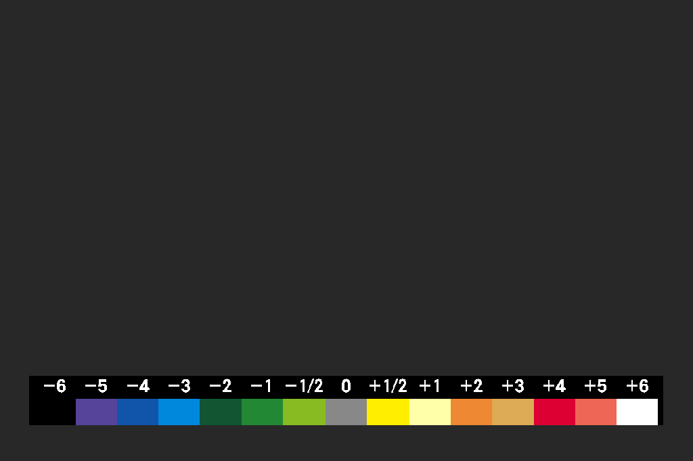
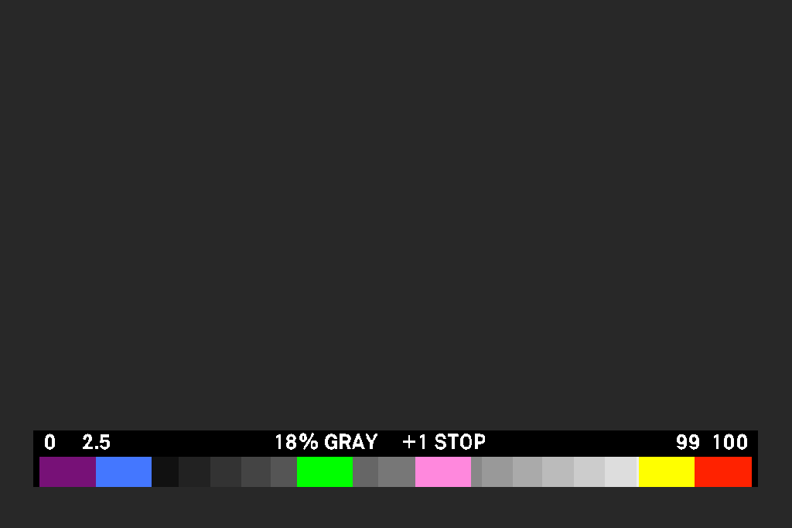

# fp EL Zone / False Color toggle + legends

A RAM-only AutoRun card for the **SIGMA fp, firmware Ver.5.02**. It turns the
camera's False Color / EL Zone button into a **toggle** and draws the camera's
own **legend** across the bottom of live view: the EL Zone scale or the False
Color scale, depending on your False Color Style setting.




> **SIGMA fp Ver.5.02 only.** Not the fp L, not other firmware versions:
> memory addresses differ and the card will not work there.
> Unofficial and not affiliated with or endorsed by SIGMA. Use at your own risk.

## What it does

- **Toggle instead of hold.** Short press on the button assigned to False
  Color: colours on; short press again: off. (Stock False Color only shows
  while the button is held.)
- **Half-second hold** while the colours are on: show or hide the legend.
  A hold while everything is off turns on colours *and* legend.
- **The legend remembers how you left it.** Turn off with the legend shown,
  and the next short press brings it back shown; hidden stays hidden. After
  each camera start the legend begins hidden.
- **Both legends**, taken from the firmware's own data (colours, band
  positions and label glyphs), drawn at 90 % width with a translucent backdrop:
  - EL ZONE style: −6 … +6 stops. Labels beyond the clipping point turn red:
    **+4, +5, +6 at ISO 100/200**, **+6 at ISO 400/3200**, all white at other
    ISOs. The band colours are the same at every ISO.
  - FALSE COLOR style: 0 · 2.5 · 18 % Gray · +1 Stop · 99 · 100 (IRE).
- Survives menus, playback and autofocus interruptions; re-asks the camera if
  it ignores an ON request while it is still settling (typically just after
  leaving the menu).
- Safe to load over an older build after a power-switch restart: the card
  disconnects whatever was running before rewriting it.
- Faster boot: the shell's per-character delay is switched off while the card
  loads and restored at the end.

It changes only what is drawn on the screen and how the button behaves. It
does not change the colours painted over the image, sensor processing, ISO,
recording, or any setting. Nothing is written to the camera's flash.

## Install

1. In the camera: **Menu → Custom → button settings**, assign **False Color**
   to a button.
2. Download `AutoRun.txt` from the latest
   [release](../../releases/latest) and copy it to the **root of the SD card**.
   Keep only one `AutoRun.txt` on the card.
3. Camera off, battery out for 10 seconds, battery in, start the camera.
   Wait for **"fp ELZone/FC ready"** on the screen the first time.

**To remove it:** delete `AutoRun.txt` from the card, take the battery out for
10 seconds and start again. The power switch alone keeps the card in memory
(it is a warm restart), so always pull the battery when removing it or when
switching to a different card.

## Status and known limits

- Tested on one camera. Everything below is checked in an ARM emulator against
  the real firmware image on every build (see *Tests*), but the emulator cannot
  show how every screen transition behaves on a real camera.
- The red clipping labels come from a published latitude chart (ISO 100: about
  +3.1 stops above middle grey; ISO 800: about +6.1) and the observation that
  low ISOs in fp video behave like a brightness label rather than real gain.
  They are not yet measured per ISO on a camera; in particular ISO 200 may
  hold up to about +4. Reports are welcome.
- During recording the camera itself does not show False Color / EL Zone; the
  toggle may read "on" with nothing displayed.
- Pressing the button in the first second or two after a power-switch restart,
  before the card starts loading, while a different older build is still in
  memory, cannot be guarded against. Wait for "ready" after changing cards.

## Build from source

You need the SIGMA fp **Ver.5.02** firmware file (`FP__V502.BIN`, from SIGMA's
support site), Python 3.9+, `clang` (macOS: `xcode-select --install`) and `curl`.

```sh
./setup.sh /path/to/FP__V502.BIN   # once: venv, fpSup's assembler, unpack MAIN
./build.sh                          # -> builds/fcscale-fast/AutoRun.txt
./test.sh                           # build + all offline checks, ~3-5 minutes
```

The builder reads the legend data straight out of your firmware image, so the
repository itself contains no firmware bytes; `analysis/`, `reference/`,
`builds/` and the generated `src/fcscale_native.inc.S` are never committed.

### Tests

- `tools/verify_autorun_replay.py` replays the real `AutoRun.txt` line by line,
  with display frames and button presses arriving in between: cold start, a
  power-switch restart with an early press, a restart over a different build,
  and a control without the disconnect step that must fail.
- `tools/verify_gestures.py` runs 91 scenarios: every gesture, the remembered
  legend, menu/playback/autofocus interruptions, ignored ON requests, warm
  restarts, and both legends pixel by pixel against the firmware's own tables.
  It writes preview PNGs to `builds/fcscale/`.

## How it works, briefly

The camera runs `AutoRun.txt` from the SD card at boot; its `mem set` lines
place ARM code in unused RAM. Four one-instruction hooks connect it: the False
Color button's press and release methods, the CameraIF constructor (to reset
state on each boot), and the display submit, where the legend is painted into
each frame on its way to the screen. A small task polls for the half-second
hold, ISO changes and menu returns. Details are in the comments of
`src/fcscale.S` and `tools/build_fcscale_autorun.py`.

## Credits

- **lachgil** — [sigma-fp-lab](https://github.com/lachgil/sigma-fp-lab): the
  original False Color / EL Zone toggle and scale, its build tool and the
  firmware extractor (`tools/inspect_firmware.py`). This project started from
  that code.
- **bei / ijigen** — [fpSup](https://github.com/ijigen/fpSup): the research this
  builds on (AutoRun, the `echo` call slot, warm restarts, display layers, task
  ABI) and the assembler wrapper `armasm.py` (GPL-3.0), which `setup.sh`
  downloads from fpSup at a pinned commit. This project is not fpSup and is not
  endorsed by it.
- **Andy_hal9000** — the per-character delay tip that shortens boot.

## Licence

No licence has been chosen yet. Parts of this code are derived from
lachgil/sigma-fp-lab, which publishes no licence; please ask before reusing
those parts. fpSup's `armasm.py` is GPL-3.0 and is not included here.
